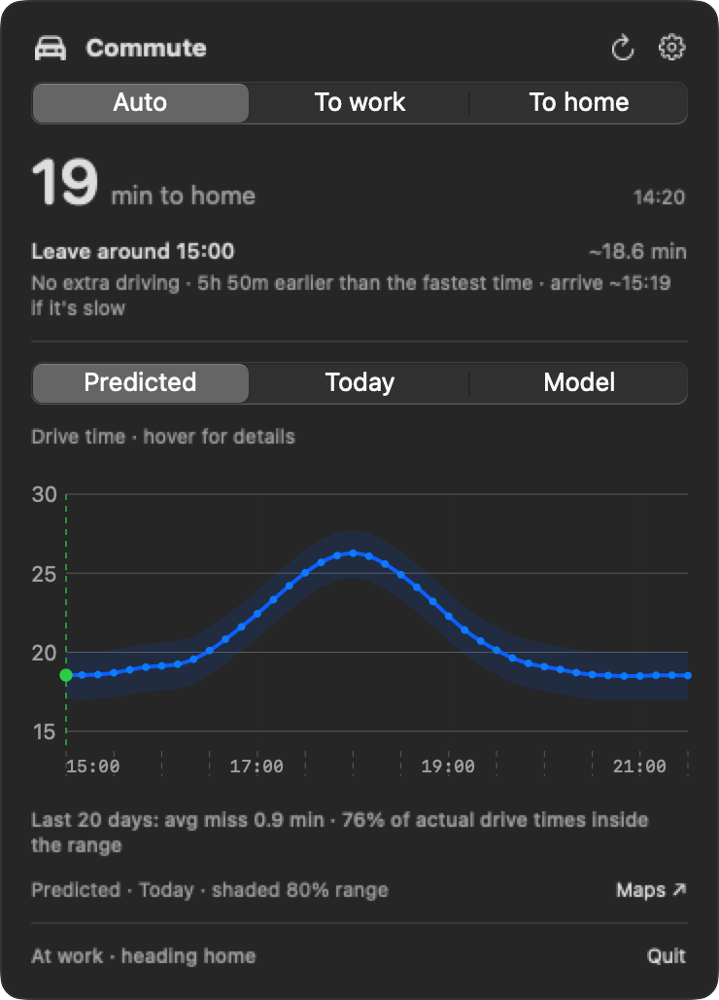

# Commute Bar

A macOS menu-bar app that tracks your drive between home and work and tells you when to leave. It samples Google Maps traffic every 10 minutes, learns your commute's daily rhythm, and forecasts drive time with an 80% range — all on your Mac, with no server, no account, and no API key.

<p align="center"></p>

## Features

- Live drive time in the menu bar for both directions, with an Auto mode that picks the direction from your location.
- A forecast curve and a "leave by" suggestion based on the extra driving you are willing to accept.
- Optional notifications when it is time to leave or traffic is running heavier than forecast.
- Weekends, holidays, and your own days off are modelled separately from weekdays.

## Requirements

- macOS 13 or later
- Xcode Command Line Tools (`xcode-select --install`)
- Python 3.12 or newer (for example `brew install python`)
- Network access on first build (downloads Playwright and Chromium)

## Install

```sh
git clone https://github.com/conjfrnk/commute.git
cd commute
./scripts/build-app.sh
open 'build/Commute Bar.app'
```

The first build also creates `./venv` and installs Playwright and Chromium.

On first launch, Settings opens automatically. Enter your home and work addresses — optionally the intermediate streets of your usual route for each direction — and save. Allow Location Services so Auto can pick the direction (within 600 m of home it assumes you are going to work, within 600 m of work it assumes you are heading home), and allow notifications if you want them.

The app is a thin launcher for this checkout: it runs the Python scripts here and keeps all of your data here, so do not move or delete the folder — rebuild the app after moving it. Turn on **Launch at login** in Settings to start it automatically. To keep a specific bundle identifier, build with `BUNDLE_ID=... ./scripts/build-app.sh`; changing it otherwise makes macOS ask for location and notification permissions again.

## How it works

- **Sampler** (`commute_sampler.py`): a headless Chromium loads the Google Maps directions page for both directions every 10 minutes, around the clock. Scraped drive times are validated before being written to a per-route CSV; failed samples retry with backoff, and the app restarts a stalled sampler.
- **Learned model** (`commute_model.py` + `commute_statespace.py`): a Kalman state-space model learns each day's persistent deviation and retrains nightly. Labels move from Collecting data through Typical (learning) and Predicted (calibrating) to Predicted; see [docs/MODEL.md](docs/MODEL.md).
- **Departure rule**: going home, it suggests the earliest departure within your driving allowance of the fastest remaining drive; going to work, a time near the middle of your window, weighing distance from the middle against extra driving.
- **Days off**: weekends, US federal holidays, and dates you list are sampled but learned and forecast as separate streams, and never trigger notifications.

## Settings

One window covers: home and work addresses; weekday departure windows in HH:mm local time (sampling runs 24/7 — the windows only choose which samples feed the forecast and suggestions); a driving allowance of 0–30 minutes (default 5); preferred-route waypoints per direction; days off; notifications; launch at login; and **Show data in Finder**.

### Optional: rain

Add `"weather_lat"` and `"weather_lon"` (for example `39.78`, `-89.65`) to `commute_settings.json` and the model learns how rain slows your drive. The nightly job then queries Open-Meteo with those coordinates; it is off by default.

## Data and privacy

Your addresses and drive history stay on your Mac, in this folder: `commute_settings.json`, `commute_live_*.csv`, `commute_model_*.json` and `commute_sampler.log`. All of them are git-ignored; keep it that way if you fork. The only network traffic is Google Maps (through the headless browser), Apple's geocoder (to place your addresses for Auto direction) and, if you opt in, Open-Meteo. There is no telemetry.

## Limitations

- macOS only, built from source — there are no signed releases.
- The Mac must be awake for samples to be taken (it catches up after sleep).
- Holidays cover US federal days only; switch that off in Settings or add your own dates.
- Route parsing expects the English Google Maps page (minutes/hours, miles/km); a page change can break it.
- It forecasts what Google Maps will show, not incidents, and the time zone follows macOS.
- Requires Python 3.12 or newer; older versions fail two numerically sensitive model tests.

## Disclaimer

Commute Bar is unofficial and is not affiliated with or endorsed by Google. It uses no API key: the sampler loads the public Google Maps directions page in a headless browser (two page loads every 10 minutes) and reads the drive time it shows. Automated access can conflict with Google's Terms of Service, so use it only for your own commute at this low rate, do not redistribute the data it collects, and expect it to break or be blocked whenever Google changes the page. Use at your own risk; the software is provided as is (see [LICENSE](LICENSE)). Optional rain data is by [Open-Meteo.com](https://open-meteo.com/) under [CC BY 4.0](https://creativecommons.org/licenses/by/4.0/); its free API is for non-commercial use.

## Development

```sh
python3 -m unittest discover -v   # hermetic: never reads your settings or data
venv/bin/python commute_sampler.py --once             # sample both directions now
venv/bin/python commute_sampler.py --request-refresh  # ask a running sampler to sample now
venv/bin/python commute_data.py                       # print the snapshot JSON the app reads
venv/bin/python commute_model.py --status             # per-direction model label and readout
venv/bin/python commute_model.py --sync --rebuild     # the nightly training job (rebuild variant)
```

The built app also accepts `--check-data`, `--render-preview` and `--render-settings` (previews are written to `build/` and render your real data).

Layout: `Sources/CommuteBar` is the SwiftUI app; `commute_sampler.py`, `commute_config.py`, `commute_data.py`, `commute_model.py` + `commute_statespace.py`, and `commute_calendar.py` are the Python side; [docs/MODEL.md](docs/MODEL.md) documents the model. `COMMUTE_TZ` overrides the time zone for the Python tools and `COMMUTE_SETTINGS` points them at an alternate settings file.

## License

MIT — see [LICENSE](LICENSE).
